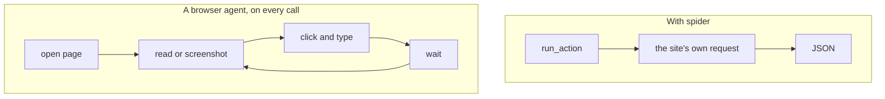
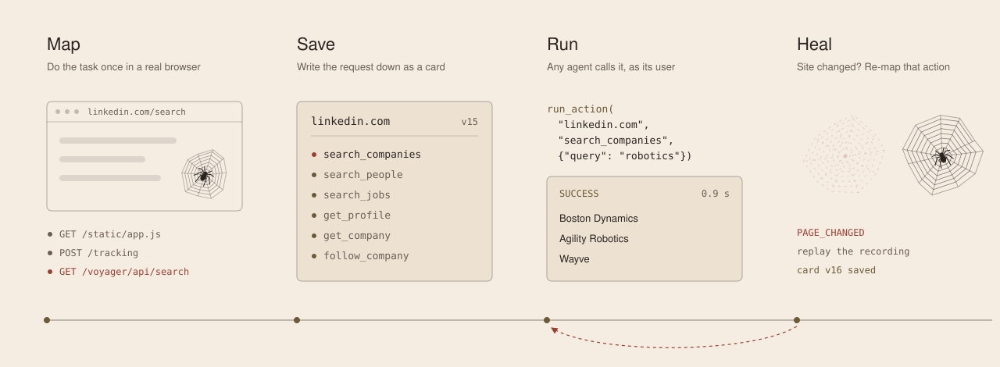
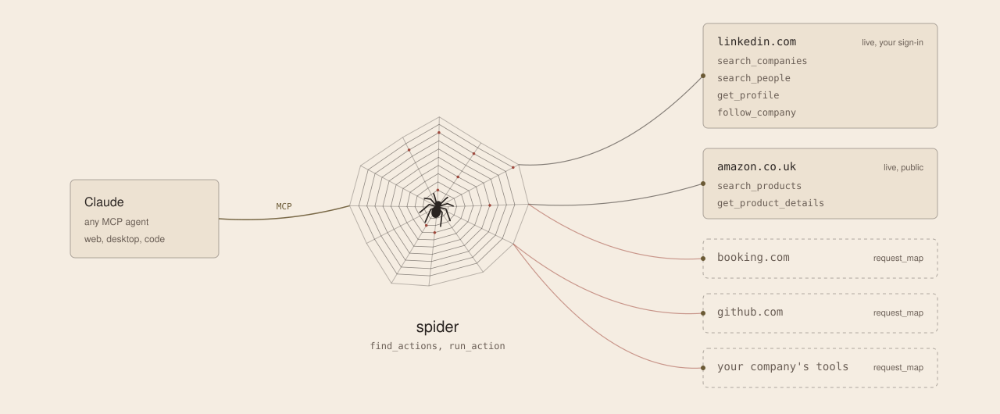
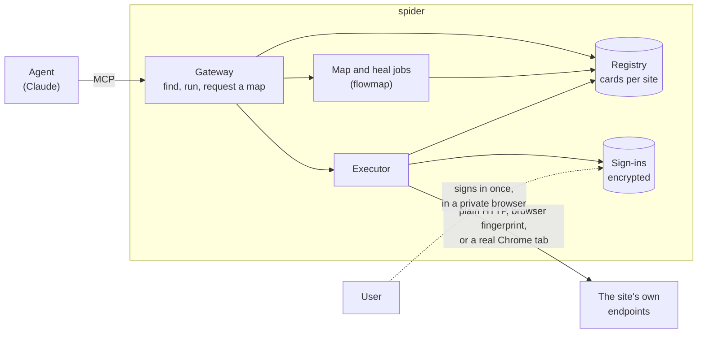
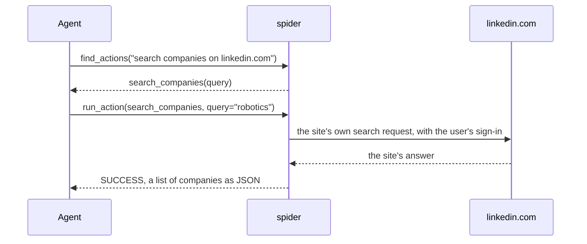
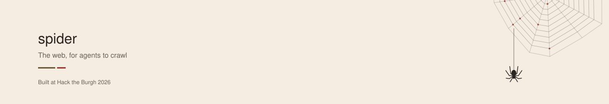

<picture>
  <source media="(prefers-color-scheme: dark)" srcset="docs/images/banner-dark.svg">
  
</picture>

spider turns websites into tools an AI agent can call directly, without driving a browser.

An agent asks for `linkedin.com` / `search_companies` with `{"query": "robotics"}` and gets clean JSON back in
about a second, signed in as its user. Behind that call is no screenshot, no clicking and no page to read: just
the same request LinkedIn's own page would have sent.

Built for Hack the Burgh 2026.

## Why

Agents mostly use websites the way a person does. A browser agent opens the page, reads it or looks at a
screenshot, clicks, types, waits, and reads again. That works, but on every single call it is:

- **Slow.** One search is tens of seconds and many model turns.
- **Expensive.** Every page the model reads costs tokens, every time.
- **Fragile.** A moved button or a new pop-up breaks it.

Public APIs would be better, but most sites people care about don't have one, or have one that doesn't cover
what people actually do there (LinkedIn, Amazon, job boards, internal tools).

There is a third way. Every modern site already has an API: the internal requests its own pages make to fetch
search results, load a profile or follow a company. Those requests are fast and return structured data. They
just aren't written down anywhere an agent can use.

spider writes them down. It watches a task being done once, works out which request is the real action, and
saves it so any agent can call it from then on.



## What spider does

A site's actions are kept in one JSON file, its **card** (`CARD_SPEC.md`, explained in `docs/cards.md`). Each
action says what request to send, where the inputs go, and where the results are in the answer. A card is made
once and shared by every user; each user signs in with their own account.

<picture>
  <source media="(prefers-color-scheme: dark)" srcset="docs/images/how-it-works-dark.svg">
  
</picture>

1. **Map.** Claude (or a person) does the task once in a browser. spider replays it with planted marker values,
   sees which request carries the input and which response carries the results, and confirms it by replaying
   with that request blocked: if the results vanish, that request is the action. The model only does the task
   and names things; which request is the action is decided from the evidence.
2. **Save.** The action goes into the site's card. Example values and fixed request values are checked for
   personal data first, and every version is kept so a bad change can be rolled back.
3. **Run.** Agents connect over MCP, find actions with `find_actions` and call them with `run_action`. Each call
   uses the user's own sign-in, and moves from plain HTTP up to a real Chrome tab only when the site needs it.
4. **Heal.** When a site changes and an action breaks, spider replays that action's recording, re-maps it and
   saves a new card version while the call waits or retries.

Writes (follow, send, add to cart) are handled carefully at both ends. While mapping, the request that would
commit the write is held back in the browser, so the site never receives it. Once saved, a write always needs
the user's confirmation before it is sent.

## How it fits together

<picture>
  <source media="(prefers-color-scheme: dark)" srcset="docs/images/sites-dark.svg">
  
</picture>



What happens on one call:



The agent never sees a password or a cookie. If the user hasn't signed in to the site yet, the call returns a
sign-in link instead; the user signs in to the real site in a private remote browser, and spider keeps the
session encrypted.

## Repository

All code is one package, `spider`, under `src/`. Tests mirror it under `tests/`.

| Path | What |
|---|---|
| `src/spider/card/` | The card format in code: models, result envelope, placeholders, validation, `python -m spider.card.check` |
| `src/spider/gateway/` | The MCP gateway (`python -m spider.gateway`): `tools.py` (what agents see), `app.py` (wiring) |
| `src/spider/run/` | Running an action: the executor, confirmation ids and redaction |
| `src/spider/run/request/` | Building each request (templates), reading the answer (extract), spotting signals |
| `src/spider/run/tiers/` | How requests go out: plain HTTP and a browser fingerprint (`http`), or a real Chrome tab (`browser`) |
| `src/spider/signin/` | Signing users in: the flow, device identity, proxy, and `neko/` (remote sign-in browsers) |
| `src/spider/store/` | Everything kept in SQLite: cards and their search, stored sign-ins, users and keys, jobs, OAuth |
| `src/spider/jobs/` | Heal jobs and map jobs |
| `src/spider/web/` | The page design and `pages/` (home, sign-up, account, website sign-in) |
| `src/spider/mappers/` | The two mappers, in the same shape (below) |
| `tests/` | Mirrors `src/spider/`; `tests/sites/` holds the demo shop (`fixture_site/`) and the bookshop |
| `cards/` | The live, checked cards: linkedin.com (12 actions) and amazon.co.uk (2). Explained in `docs/cards.md` |
| `CARD_SPEC.md`, `action_map.example.json` | The card format (v0.4) and an example card |
| `flows/bookshop.test/` | Example flowmap recordings |
| `docs/` | Cards (`cards.md`) and the two mappers (`flowmap.md`, `harmap.md`) |

Both mappers have the same stages, so the same file name means the same job in each:

| | flowmap | harmap |
|---|---|---|
| `cli.py` | `python -m spider.mappers.flowmap` | `python -m spider.mappers.harmap` |
| `record/` | Claude or a person does the task once; browser steps, held-back writes | A person records each run; saved traffic |
| `infer/` | Which request is the action, its inputs, outputs and names | The same, from the saved traffic, stage by stage |
| `card/` | Assemble the action, privacy check, sign-in check | Assemble, validate, mapping report |
| `heal.py` | Replays the broken action | Re-records and re-maps the site |
| only here | `serve/`: map jobs and exploring a site, inside the gateway | `explore/`: an LLM picks a site's tasks; `helpers/` |

`DECISIONS.md` records every judgement call made while building (L-series runtime and sign-in, M-series mapper).

## Two mappers

A mapper turns a task done once in a browser into a card. The repository has two. **flowmap is the one the
product runs:** map jobs (`request_map`), healing and nearly every action in `cards/` come from it, and it is
what the Hack the Burgh demo used. harmap came first; three LinkedIn actions (`get_me`,
`send_connection_request`, `start_conversation`) and the card format's streamed-rows support come from it.

| | flowmap | harmap |
|---|---|---|
| Recording | Once, by Claude (`--agent`) or a person, saved as browser steps | Three or four times by hand (two with marker values, one real, one on page 2), saved as network traffic (HAR) |
| Finding the request | Replays the steps itself with fresh markers, matches what the page shows to the answers, and confirms by blocking the request: if the results vanish, that request is the action | Searches the saved traffic for the markers, in nine steps (`pipeline/`) |
| Where it runs | Command line, and inside the gateway as map jobs | Command line only |
| Writes | The send is held back from the first click that would commit; the steps before it are tried on each tier before saving | The send is held back during capture |
| Privacy | Examples and fixed values checked for personal data (rules, then Claude) | No live secrets in the card |
| Healing | Replays just the broken action | Re-records and re-maps the whole site |

## Quick start

Needs Python 3.12 and [uv](https://docs.astral.sh/uv/).

```bash
uv sync --extra llm
uv run playwright install chromium
cp .env.example .env
```

Set `GATEWAY_API_KEY` and `CONFIRMATION_SECRET` in `.env`, and `SESSION_KEY`
(`uv run python -m spider.store.sessions` prints one). Then run the demo shop and the gateway, in two terminals:

```bash
uv run uvicorn tests.sites.fixture_site.app:app --port 8900
```

```bash
uv run python -m spider.gateway --load tests/sites/fixture_site.json
```

Add it to Claude Code:

```bash
claude mcp add --transport http spider http://127.0.0.1:8765/mcp --header "Authorization: Bearer <GATEWAY_API_KEY>"
```

Then ask Claude: "use spider to search the fixture.test shop for lamps".

To also load the real sites' cards (LinkedIn needs each user to sign in with their own account):

```bash
uv run python -m spider.gateway --load tests/sites/fixture_site.json --load cards/linkedin.com.json --load cards/amazon.co.uk.json
```

The demo shop (`tests/sites/fixture_site/`) has 21 actions covering every runtime case: reads, writes that need
confirmation, rate limits, bot challenges, browser-only endpoints, and a sign-in (`demo` / `demo-password`).
`POST http://127.0.0.1:8900/_admin/break` moves one endpoint so you can watch an action heal;
`/_admin/reset` puts it back.

## MCP tools

The endpoint is `<PUBLIC_BASE_URL>/mcp` (Streamable HTTP, `Authorization: Bearer <key>`, or OAuth for regular
Claude).

| Tool | What it does |
|---|---|
| `find_actions` | Search the registry for actions that fit a task ("search companies on linkedin.com") |
| `run_action` | Run one action with inputs; writes return a confirmation id first |
| `request_map` | Ask for a site, or one named action on it, to be set up when nothing fits |
| `map_status` | Progress of a map job |
| `heal_status` | Progress of a heal job after a `PAGE_CHANGED` result |
| `start_connection` | Get a sign-in link for a site that needs the user's login |
| `poll_connection` | Wait until the user has signed in |
| `connection_status` | Which sites the user is signed in to |
| `disconnect` | Delete a stored sign-in and its browser profile |

Every result is one envelope (`src/spider/card/envelope.py`): a status (`SUCCESS`, `EMPTY`, `NEEDS_CONFIRMATION`,
`AUTH_EXPIRED`, `PAGE_CHANGED`, `BLOCKED`, ...), the data, and what to do next.

## Using spider from regular Claude (web, desktop, phone)

In Claude: Customize, Connectors, Add custom connector, URL `<PUBLIC_BASE_URL>/mcp`, then Connect. Claude registers
itself and opens spider's sign-in page (password, an API key, or a new account with the invite code).
`PUBLIC_BASE_URL` must be the https address people reach, for example an ngrok domain.

The gateway serves its own pages (`src/spider/web/design.py`): home `/`, sign-up `/signup`, sign-in `/account/login`, the
account page `/account` (waiting sign-ins, sites, connected apps, API key), Claude's sign-in `/oauth/login`, and
the website sign-in `/connect/<token>`. `PRODUCT_NAME` sets the name shown on them.

## Users and keys

Every key belongs to one user, and every call acts as that user: their own sign-ins, browser profiles and device
identity. `GATEWAY_API_KEY` is user `default`. Everyone else gets their own key:

- **Sign-up page:** set `SIGNUP_CODE` and share it; people open `/signup`, enter the code, a name and an email,
  and get their key once with the `claude mcp add` line. Wrong codes are rate limited.
- **Command line:** `uv run python -m spider.store.users add alice --email alice@example.com` (also `list`, `reissue`,
  `revoke`, `set-password`). Keys are shown once; only their SHA-256 is stored.

## Setting up a new site

### From an agent (map jobs)

With `MAPPER=flowmap` and `ANTHROPIC_API_KEY` set, an agent that finds nothing for a site calls `request_map`.
The gateway maps it on the server: one named action ("search products on amazon.co.uk") in a few minutes, or the
whole site's main reads. The account page shows the job's progress; `map_status` reports it to the agent. A site
that needs a sign-in pauses the job and returns a sign-in link, then carries on.

A specific change ("follow this company") goes through `request_map` with `write: true`. The click that would
commit it is held back, and before the write is saved, its steps up to the send are tried on each tier to find
one that works.

`MAP_ALLOW_LOCAL=1` also allows sites on this machine (the bookshop test site:
`uv run uvicorn tests.sites.bookshop:app --port 8911`).

### From the command line (flowmap)

```bash
# have Claude record an action once (or drop --agent and do it yourself in the browser that opens)
uv run python -m spider.mappers.flowmap record https://example.com/ --action search_things \
  --agent "search for the query" --input query=lamp --example query=chair

uv run python -m spider.mappers.flowmap map example.com            # replay, infer, check, save to the registry
uv run python -m spider.mappers.flowmap show example.com           # the card and recent heal timings
uv run python -m spider.mappers.flowmap heal example.com search_things
```

Full reference: `docs/flowmap.md`. harmap (`python -m spider.mappers.harmap explore | capture | map | heal`) is described in
`docs/harmap.md`.

## Healing

When an action returns `PAGE_CHANGED`, the runtime queues a heal job, checks first that the cause isn't a block
or an expired sign-in, then asks the remapper to re-map just the broken action. The new card is validated against
the action's `examples` and saved as a new version. `REMAPPER` picks the remapper:

- `flowmap`: replays the action's recording from `FLOWS_DIR/<domain>/<action>.json`.
- `harmap`: replays harmap's recordings from `CAPTURES_DIR/<domain>/`.
- `tests.sites.fixture_site.remapper:FixtureRemapper`: a stand-in for the demo shop.

## Sign-in and the browser tier

Sites with `connect_providers` need the user's sign-in once. The agent calls `start_connection` and shows the user
a link. There the user signs in to the real site in a private browser in a short-lived Neko container, streamed
to their screen. spider checks the cookies with the provider's `session_check` and stores them encrypted with
`SESSION_KEY`; the agent never sees a password or cookie. Cookies the site refreshes are saved back, and the
sign-in browser's identity (user agent, client hints, language) is presented on every later request.

- **Neko:** needs Docker and `docker pull ghcr.io/m1k1o/neko/chromium:latest`. Hosted: set `NEKO_PUBLIC_IP`, open
  `NEKO_UDP_PORTS` (UDP and TCP), and add a TURN server in `NEKO_ICE_SERVERS` for strict networks.
- **Residential proxy (optional):** set `PROXY_URL` to a sticky-session URL with `{session}` where the session id
  goes. Each sign-in keeps one home IP; public actions go direct.
- **Browser tier:** installed Chrome (`uv run playwright install --with-deps chrome` on a server); keep
  `PROFILES_DIR` and the database on persistent storage.

Every setting is described in `.env.example`.

## Tests

```bash
uv run pytest
uv run ruff check .
uv run ruff format --check .
```

Tests run in parallel. Those that need Docker, Neko or a Playwright browser skip themselves when it isn't
installed; two of harmap's tests need `uv sync --extra llm`.

## Security

Captures, HAR files, `state.json`, cookies, profiles, `runtime.db` and `.env` hold live sign-ins: they are
git-ignored and must never be committed. Logs show cookie, csrf and auth header values as `[redacted]`.

## Limits

- Sites that build everything in scripts with no readable request (browser replay) aren't supported.
- An action is set up from one real example, so a page layout the example didn't show can come back empty.
- Pages about a single item (a product page) yield one field so far.
- Writes on real sites are early: the safety path is tested on the demo shop and on LinkedIn.
- No per-user quotas, response cache or outgoing rate limit yet (`TODO`s in `src/spider/run/executor.py`).

## License

spider is licensed under the [GNU Affero General Public License v3.0](LICENSE) (AGPL-3.0-only). You may use,
study, change and share it, but if you distribute it, or run a modified version as a service for others, you
must release your source code under the same license. For other terms, ask the authors.

Copyright (C) 2026 the spider authors (see the git history).

<picture>
  <source media="(prefers-color-scheme: dark)" srcset="docs/images/footer-dark.svg">
  
</picture>
